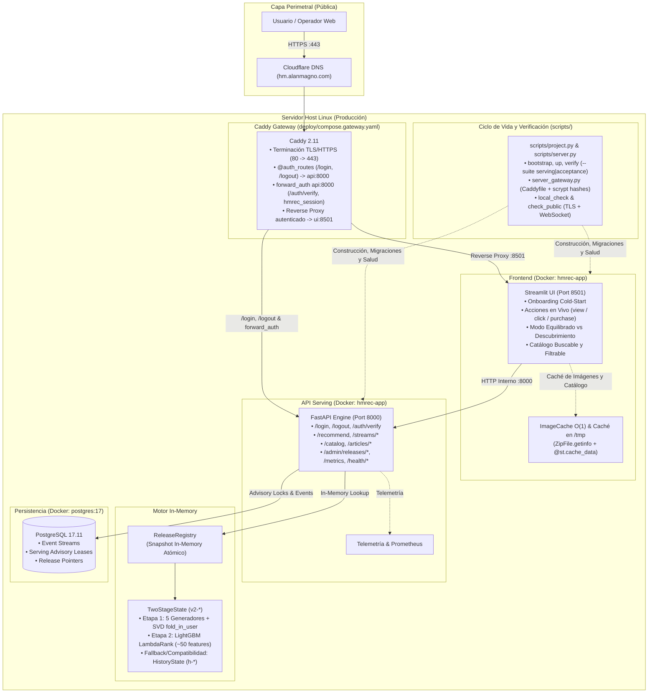

# H&M Fashion Recommender Platform
> Plataforma de recomendación híbrida de moda `v2` en tiempo real (retrieval multi-generador + ranking LightGBM LambdaRank) sobre datos masivos de compras (`31.78M` transacciones), arquitectura contenerizada de microservicios y operación reproducible en Docker.

[](https://hm.alanmagno.com/)
[](https://www.python.org/)
[](https://fastapi.tiangolo.com/)
[](https://streamlit.io/)
[](https://www.postgresql.org/)
[](https://www.docker.com/)

---

## 🌐 Demostración en Producción

El sistema se encuentra desplegado y accesible públicamente con portal de sesión en:  
👉 **[https://hm.alanmagno.com/](https://hm.alanmagno.com/)**

### Aspectos Destacados:
* **Motor Híbrido de 2 Etapas (`v2` + compatibilidad `h-*`):** Etapa 1 multi-generador (`history_decay`, `product_code_variants`, `cooccurrence`, `latent_and_content` con SVD `fold_in_user` + TF-IDF, `segment_popularity`) y Etapa 2 con LightGBM LambdaRank (~50 features temporales estrictamente `< cutoff`) más retrocompatibilidad total con paquetes `h-*`.
* **Experiencia Real de Comprador en Tiempo Real:** Onboarding rápido para cold-start (`age_bin`, `index_group_name`), acciones por prenda (`Ver detalle` -> `view`, `♡ Favorito` -> `click`, `Comprar` -> `purchase`) que actualizan recomendaciones en vivo, modos `Equilibrado` vs `Solo descubrimiento`, insignias explicables y catálogo buscable/filtrable.
* **Perfiles Descriptivos Reales:** Modelos de compradores obtenidos de historiales reales del dataset oficial de H&M Kaggle (gamas cromáticas, prendas estampadas y patrones de recompra).
* **Seguridad Perimetral y Portal de Sesión:** Caddy Gateway con TLS automático, rutas `/login` y `/logout`, `forward_auth` contra `api:8000` (`/auth/verify`), cookie `hmrec_session` firmada con HMAC-SHA256 (separación de dominio), contraseñas con `hashlib.scrypt` salado y rate limiting acotado en memoria.

---

## 🏛️ Arquitectura del Sistema



---

## 🛠️ Requisitos Previos

* **Docker Engine 24+ & Docker Compose v2** (todas las dependencias Python y herramientas viven dentro de las imágenes `hmrec-app` y `hmrec-jobs`).
* **Python 3** (únicamente librería estándar en el host para ejecutar `scripts/project.py`, `scripts/server.py` y `scripts/check_docs_links.py`; no requiere instalar `uv` en el host).

---

## 🚀 Inicio Rápido Local (Quickstart en Docker)

1. **Clonar el repositorio:**
   ```bash
   git clone https://github.com/emilianodesu/clothing-recommendation.git
   cd clothing-recommendation
   ```

2. **Inicializar `.env`, construir imágenes base (`app-check`, `jobs`), levantar bases de datos y migrar esquema:**
   ```bash
   python3 scripts/project.py bootstrap
   ```
   *(Internamente genera `.env` con secretos privados, ejecuta `docker compose --env-file .env build app-check jobs`, inicia `postgres` y `qdrant`, y corre `hmrec db migrate` y `hmrec check` dentro de `jobs`.)*

3. **Iniciar los servicios de API y UI con Docker Compose:**
   ```bash
   docker compose --env-file .env --profile serve up -d --wait api ui
   ```
   *(También puedes usar `python3 scripts/project.py up --profile serve --skip-build`.)*
   * Interfaz de Usuario (Streamlit): `http://127.0.0.1:8501`
   * Documentación de la API (Swagger/OpenAPI): `http://127.0.0.1:8000/docs`

---

## 🧪 Ejecución de Pruebas (en Docker)

* **Pruebas unitarias de motor, serving y seguridad de portal (`hmrec-jobs:0.1.0`):**
  ```bash
  docker compose --env-file .env run --rm --no-deps -T jobs python -m pytest tests/unit -v
  ```
  *(Si montas cambios locales sin reconstruir imagen: `-v "$(pwd)/src:/opt/hmrec/src:ro" -v "$(pwd)/tests:/opt/hmrec/tests:ro" -e PYTHONPATH=/opt/hmrec/src`.)*

* **Pruebas de host y gateway (`tests/host/test_server*.py`):**
  ```bash
  docker compose --env-file .env run --rm --no-deps -T -v "$(pwd):/workspace:ro" -w /workspace jobs python3 -m unittest discover -s tests/host -v
  ```

* **Verificación de enlaces locales en documentación:**
  ```bash
  docker compose --env-file .env run --rm --no-deps -T -v "$(pwd):/workspace:ro" -w /workspace jobs python3 scripts/check_docs_links.py
  ```

* **Pruebas de integración y aceptación en Docker Compose:**
  ```bash
  python3 scripts/project.py verify --suite serving
  python3 scripts/project.py verify --suite acceptance
  ```

---

## 📁 Estructura del Proyecto

```
clothing-recommendation/
├── compose.yaml              # Definición de servicios (postgres, qdrant, api, ui, app-check, jobs)
├── pyproject.toml            # Definición del paquete hm-recommender y dependencias
├── configs/quality/          # Configuraciones reproducibles de evaluación (quality-v1, etc.)
├── deploy/                   # Compose del gateway Caddy (compose.gateway.yaml)
├── docker/                   # Dockerfiles multi-stage con BuildKit (app.Dockerfile, jobs.Dockerfile)
├── migrations/               # Migraciones SQL de PostgreSQL (leases, streams, releases)
├── scripts/                  # Orquestación local/servidor (project.py, server.py, server_gateway.py, check_docs_links.py)
├── src/
│   └── hm_recommender/
│       ├── api/              # FastAPI application, portal auth/session, esquemas Pydantic y eventos
│       ├── ui/               # Streamlit application, caché de imágenes, estilos CSS e i18n
│       ├── v2/               # Motor v2 (latent SVD/TF-IDF, retrieval multi-generador, ranker, package)
│       ├── model/            # Modelos de recomendación v1 (heurística H y two-tower)
│       ├── ranking/          # Algoritmos determinísticos de desempate y deduplicación
│       ├── releases/         # Gestión de releases portables y leases de servicio
│       └── events/           # Almacenamiento y agregación de eventos de usuario
├── tests/
│   ├── unit/                 # Pruebas unitarias aisladas
│   ├── host/                 # Pruebas de admisión de host, Caddyfile, pins y runner de servidor
│   ├── integration/          # Pruebas de integración HTTP, UI y persistencia
│   └── fixtures/             # Datos sintéticos para pruebas
└── docs/                     # Documentación técnica, de operaciones y archivo histórico
```

---

## 🚢 Operación y Despliegue en Servidor

El ciclo de vida en servidor público se gestiona mediante `scripts/server.py`, `scripts/server_gateway.py` y `deploy/compose.gateway.yaml`: verificación de admisión de host, construcción de imágenes con BuildKit, configuración del gateway Caddy con `@auth_routes` (`/login`, `/logout`) y `forward_auth` (`/auth/verify`), y comprobación de salud local y pública (`local_check` y `check_public` con TLS y handshake WebSocket).

Para consultar los procedimientos detallados de diagnóstico, certificados y respaldos, consulte la [Guía de Operaciones del Servidor](docs/server-operations.md).
