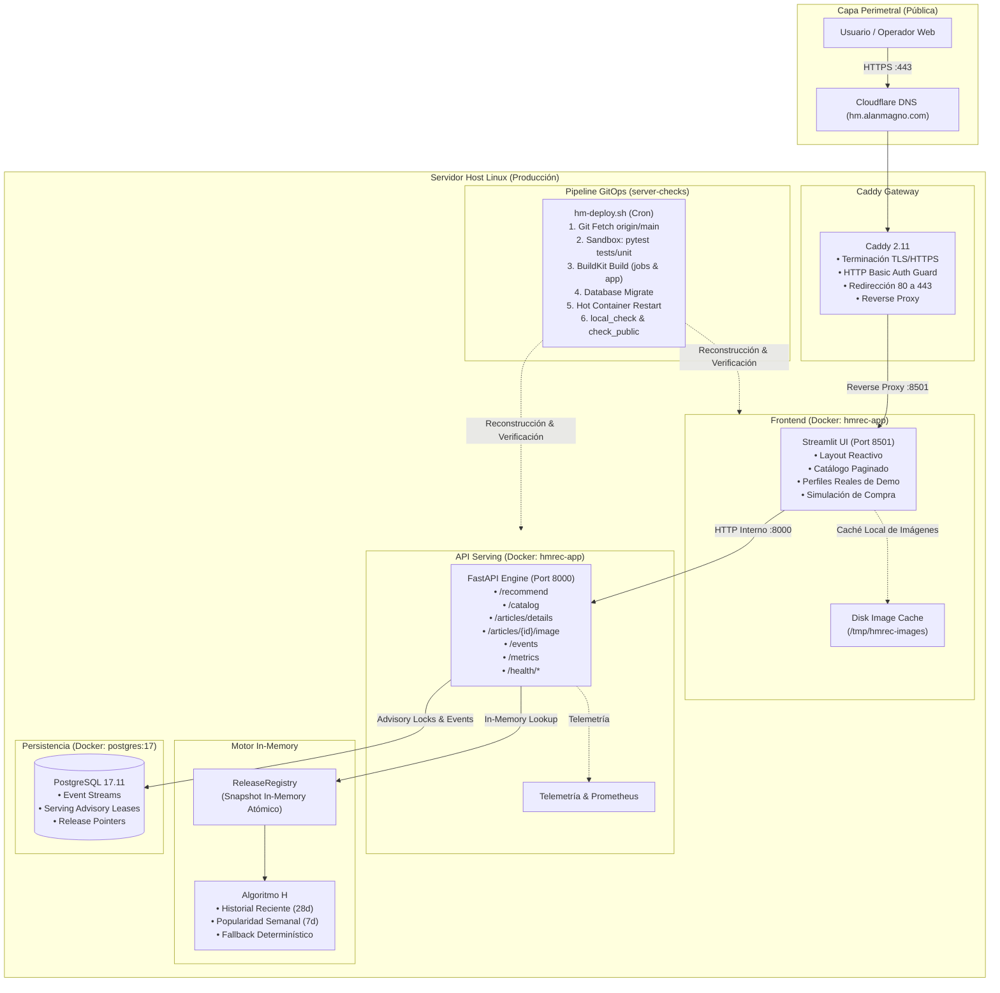

# H&M Fashion Recommender Platform
> Plataforma de recomendación personalizada de moda en tiempo real sobre datos masivos de compras, arquitectura contenerizada de microservicios y despliegue continuo GitOps.

[](https://hm.alanmagno.com/)
[](https://www.python.org/)
[](https://fastapi.tiangolo.com/)
[](https://streamlit.io/)
[](https://www.postgresql.org/)
[](https://www.docker.com/)

---

## 🌐 Demostración en Producción

El sistema se encuentra desplegado y accesible públicamente con credenciales de operador en:  
👉 **[https://hm.alanmagno.com/](https://hm.alanmagno.com/)**

### Aspectos Destacados:
* **Motor H (Recent History 28d + Popularity 7d):** Motor de inferencia heurístico ultrarrápido y determinístico especializado en recompra con fallback inteligente por popularidad semanal.
* **Simulación en Tiempo Real:** Interfaz web interactiva para simular compras y observar la adaptación reactiva e instantánea del catálogo recomendado.
* **Perfiles Descriptivos Reales:** Modelos de compradores obtenidos de historiales reales del dataset oficial de H&M Kaggle (gamas cromáticas, prendas estampadas y patrones de recompra).
* **Arquitectura de Grado Producción:** Caddy Gateway perimetral con TLS automático, API REST asíncrona, PostgreSQL relacional para eventos y telemetría Prometheus.

---

## 🏛️ Arquitectura del Sistema



---

## 🛠️ Requisitos Previos

* Docker Engine 24+ & Docker Compose v2
* Python 3.12 con [Astral `uv`](https://github.com/astral-sh/uv) (gestor de paquetes de alto rendimiento)

---

## 🚀 Inicio Rápido Local (Quickstart)

1. **Clonar el repositorio:**
   ```bash
   git clone https://github.com/emilianodesu/clothing-recommendation.git
   cd clothing-recommendation
   ```

2. **Instalar dependencias del entorno:**
   ```bash
   uv sync --extra ui
   ```

3. **Iniciar los servicios con Docker Compose:**
   ```bash
   docker compose --profile serve up -d
   ```
   * Interfaz de Usuario (Streamlit): `http://localhost:8501`
   * Documentación de la API (Swagger/OpenAPI): `http://localhost:8000/docs`

---

## 🧪 Ejecución de Pruebas

* **Pruebas unitarias de motor y API (ejecutadas en sandbox):**
  ```bash
  uv run pytest tests/unit -v
  ```

* **Pruebas de integración de base de datos y UI:**
  ```bash
  uv run pytest tests/integration -v
  ```

---

## 📁 Estructura del Proyecto

```
clothing-recommendation/
├── compose.yaml              # Definición de servicios (postgres, api, ui, etc.)
├── pyproject.toml            # Definición del paquete hm-recommender y dependencias
├── docker/                   # Dockerfiles optimizados multi-stage con BuildKit
├── src/
│   └── hm_recommender/
│       ├── api/              # FastAPI application, routing, esquemas Pydantic y eventos
│       ├── ui/               # Streamlit application, estilos CSS e internacionalización
│       ├── model/            # Modelos de recomendación (heurística H y two-tower)
│       ├── ranking/          # Algoritmos determinísticos de desempate y deduplicación
│       ├── releases/         # Gestión de releases y leases de servicio
│       └── events/           # Almacenamiento y agregación de eventos de usuario
├── tests/
│   ├── unit/                 # Pruebas unitarias ultrarrápidas aisladas
│   ├── integration/          # Pruebas de integración HTTP y persistencia
│   └── fixtures/             # Datos sintéticos para pruebas
└── docs/                     # Documentación técnica, de operaciones y archivo histórico
```

---

## 🚢 Operación y Despliegue en Servidor

El despliegue en servidor se gestiona mediante el pipeline automatizado `server-checks/hm-deploy.sh`, que vigila `origin/main`, ejecuta pruebas unitarias en contenedor cerrado sin red, reconstruye imágenes con BuildKit y realiza validaciones locales y de certificados HTTPS antes de conmutar tráfico.

Para consultar los procedimientos detallados de diagnóstico, certificados y respaldos, consulte la [Guía de Operaciones del Servidor](docs/server-operations.md).
