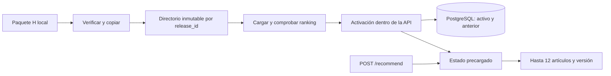

# Servicio local H (T4-B)

La API sirve el motor H seleccionado en Q4. Consume el paquete schema2 aprobado
en T4-A; no entrena, consulta Qdrant ni necesita MLflow. PostgreSQL guarda las
versiones preparadas y el puntero activo/anterior. La imagen conserva las
dependencias experimentales bloqueadas; aún no es una imagen mínima.

`prepare-release` verifica inventario, hashes, schema y orden temporal, copia el
paquete a un temporal, comprueba una consulta, sincroniza archivos y publica por
rename. Luego registra identidad y hash del manifiesto. No activa. Una copia
fallida deja diagnóstico sin cambiar la versión activa. Los originales de T4-A
se montan en lectura; sólo `ARTIFACTS_DIR/serving` es escribible por la API.

`activate-release` carga completamente el candidato antes de tocar el puntero.
Dentro de una sección crítica confirma la transacción PostgreSQL y cambia una
referencia en memoria. Una petición retiene su objeto de versión durante toda su
ejecución: respuestas iniciadas antes del cambio pueden terminar con la versión
anterior y siguen siendo coherentes. La versión anterior permanece en disco y
en PostgreSQL para rollback. Activar la misma versión es idempotente.

Si falla la validación del candidato, se conserva el servicio anterior. Si la
confirmación de la transacción queda incierta, la API deja de estar lista y
devuelve 503: recuperar o reiniciar carga el puntero realmente confirmado.
Un paquete activo corrupto impide arrancar; no se elige silenciosamente otro.

Sólo un proceso puede poseer el registro: un advisory lock PostgreSQL de sesión
impide dos propietarios sobre la misma base/esquema. Cada solicitud comprueba
que esa conexión sigue viva antes de obtener el snapshot. Perderla detiene las
recomendaciones; no hay reconexión silenciosa que omita adquirir el lock.
La transacción que cambia el puntero usa esa misma sesión: un propietario que
la perdió no puede escribir desde otra conexión después de que entre su sucesor.
Uvicorn usa un worker. Escalar a varios procesos requiere otro contrato de
coordinación; no basta cambiar `workers`.

## Contrato HTTP

- `POST /recommend`: `customer_id` no vacío, `k` entero 1–12 (default 12), `filters`
  opcional. IDs son cadenas, incluidos ceros iniciales. No se aceptan claves extra.
- Filtros de igualdad: `product_type_name`, `product_group_name`, `colour_group_name`.
  Se intersectan antes de seleccionar hasta 200 candidatos y devolver hasta 12.
  Se conservan compras previas; no hay duplicados. Un filtro sin coincidencias
  devuelve una lista vacía. Valores nulos o claves desconocidas devuelven 422.
- Respuesta: `request_id`, `release_id`, `strategy`, `features_timestamp` (corte
  histórico), `fallback` e `items: [{article_id, rank, reason}]`. Razones:
  `recent_purchase` o `popular_7d`. El ordinal no es una probabilidad.
- `fallback=true` significa que no hay historial **elegible**; también puede
  ocurrir con un comprador conocido cuyo historial quedó fuera del filtro.
- `GET /health/live`: proceso y huella del código. `GET /health/ready`: 200 y
  versión activa, o 503 si no existe estado válido. El healthcheck del contenedor
  usa liveness para permitir preparar la primera versión sin reinicios continuos.
- `GET /metrics`: contadores agregados y suma de duración; sin compradores,
  solicitudes ni IDs de productos como etiquetas. No sustituye el benchmark T8.

La calidad bajo filtros no está medida. T4-A comprobó top200 offline para todos
los compradores V3; T4-B añade pruebas de contrato y paridad HTTP muestreada.
No se consultan etiquetas de validación/test durante el ensayo de servicio.

## Operación y límites

La API se publica sólo en `127.0.0.1`, sobre una red Docker interna. Los comandos
administrativos usan `/admin/releases/{prepare,activate,rollback}` con Bearer de
la credencial local de aplicación. La CLI la toma del entorno del contenedor:
no aparece en argumentos, ejemplos ni reportes. No habilitar acceso de red sin
definir autenticación por usuario y credenciales administrativas separadas.
No se registran cuerpos HTTP ni access logs; los errores de validación no repiten
el `customer_id`. Los mensajes administrativos externos omiten detalles privados.

La API tiene 4 GiB, dos CPU y dos hilos; el probe temporal tiene 3 GiB, una CPU
y dos hilos; PostgreSQL conserva 512 MiB. El presupuesto de API parte del pico
T4-A de 2.248 GiB y debe medirse con el paquete completo en mac24: el tamaño
Parquet no equivale a RAM residente. Durante una activación pueden coexistir
estados anterior y candidato. No ejecutar trabajos pesados junto al ensayo.

`serve` inicia PostgreSQL y API; Qdrant queda en perfil `experimental`, MLflow
en `training`. Bootstrap todavía inicia sus servicios de manera explícita para
comprobar los experimentos. Sus volúmenes se conservan.

Reinicio reutiliza directorios y PostgreSQL. `down` conserva ambos. Recuperación
de backups en otra instalación pertenece a T7. Eventos/Streamlit y actualización
de ventanas son T5; Airflow es T6; carga y aceptación final permanecen en T8.
