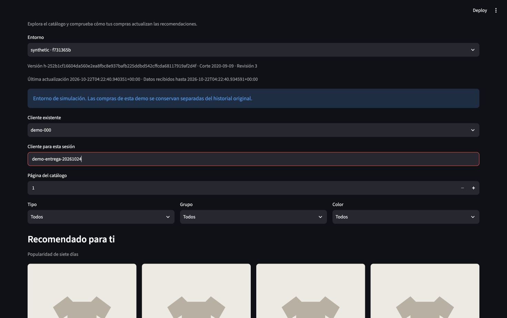
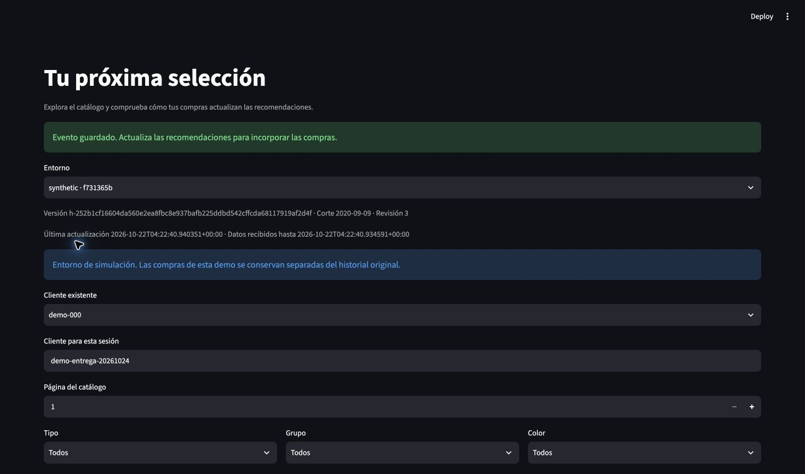
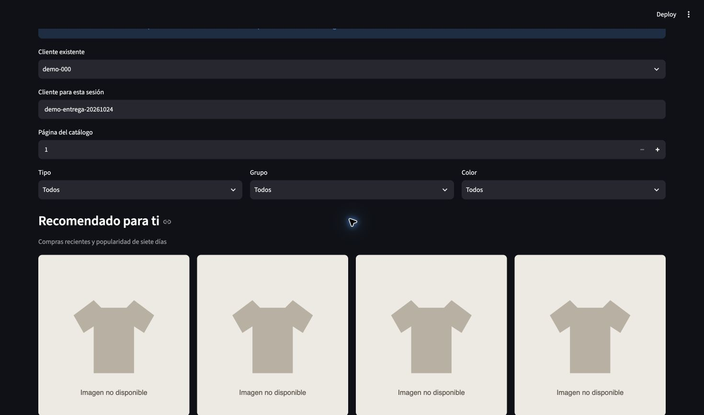
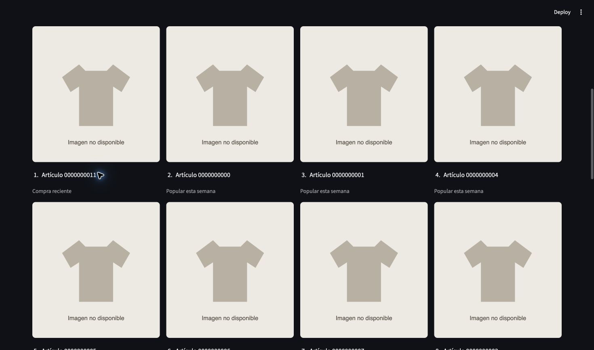

# Demostración visual sintética — 24 de octubre de 2026

Capturas reales de la interfaz local existente, catálogo de 24 artículos sintéticos. No son imágenes H&M ni una nueva instalación del último commit. [Identidad, observaciones y SHA-256](../evidence/demo-captures-local.json). La imagen de la demo es histórica; la aceptación del código actual se acredita separadamente con [60 pruebas](../evidence/acceptance-local.json).

## 1. Comprador nuevo y respaldo popular

Se introdujo `demo-entrega-20261024`, sin compras previas. La interfaz indica «Popularidad de siete días»; el artículo `0000000011` estaba en puesto 12 en la lista observada.

## 2. Compra confirmada

Se seleccionó `0000000011`, con fecha 2020-09-08, y se pulsó una vez «Registrar compra». Apareció «Evento guardado». La interacción queda guardada en el stream sintético; no se borró después de la captura.

## 3. Publicación del historial

Se pulsó una vez «Actualizar recomendaciones», manteniendo corte 2020-09-09. La estrategia cambió a «Compras recientes y popularidad de siete días».

## 4. Resultado visible

El artículo comprado pasó al puesto 1 con razón «Compra reciente». Las imágenes de sustitución son esperadas en sintéticos. El ordinal no es una probabilidad.

La cabecera de esta interfaz histórica conservó revisión 3 tras actualizar el ranking; no usarla como prueba de frescura de metadatos. La secuencia acredita la interacción y el cambio visible, no latencia, persistencia tras fallo o recuperación. Instalación, reinicio y restauración se explican con las evidencias T1/T4/T7; no se simularon ni repitieron aquí. No se tocó mac24 ni el test final.

La limitación de cabecera observada en estas capturas históricas fue [corregida y comprobada en el despliegue local posterior](ui-metadata-deployment.md). Las imágenes de esta galería permanecen intactas.
