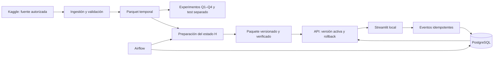

# Plataforma local reproducible de recomendaciones H&M

Informe académico · Datos Masivos · 24 de octubre de 2026

## Objetivo y alcance

Construir y evaluar un recomendador sobre compras de H&M, comparar señales temporales, representaciones latentes y vínculos entre artículos, y desplegar el procedimiento seleccionado mediante un pipeline local reproducible. El criterio es calidad medida bajo restricciones y servicio verificable; no hacer ganar un framework determinado.

La solución utiliza Docker Compose, PostgreSQL, API Python, Streamlit y Airflow. PyTorch, LightGBM, grafos y MLflow se conservan como experimentos trazables; Qdrant es infraestructura experimental y no interviene en servir el motor elegido. No depende de Hopsworks ni de nube. La reproducción física documentada se hizo en Macs ARM64; Linux/AMD64 y otra cuenta de macOS no están acreditados por estas pruebas.

## Datos y metodología

H&M aporta transacciones, catálogo y clientes; las compras son feedback implícito, no calificaciones. La ingestión T2 verifica la fuente y produce particiones Parquet. La evaluación temporal reconstruye cada estado exclusivamente con datos anteriores al corte y conserva compradores sin historial y relevantes fuera del catálogo. No se usan imágenes para seleccionar H. Datos y resultados individuales permanecen privados; GitHub contiene código y reportes agregados con inventario y SHA-256.

T3 entrenó dos torres PyTorch y conservó checkpoints y resultados negativos. Q1 evaluó historial reciente; Q2, coocurrencia ponderada y PageRank personalizado acotado; Q3, reranking LightGBM; Q4 aplicó la regla de selección previamente fijada. El test final se abrió una vez después de congelar H. Las campañas y sus fallos históricos no se borran ni se repiten para mejorar el resultado.

## Selección y explicación

| Método | Papel y resultado de validación |
| --- | --- |
| P: popularidad7d | Referencia exigente y fallback |
| Dos torres PyTorch | Una época no superó P; tres épocas no resolvieron MAP/NDCG. No prueba inferioridad general de redes neuronales |
| H: historial28d + popularidad7d | Seleccionado bajo `quality-v1`; conserva recuperación y fallback por segmento |
| G: grafo de coocurrencia | MAP medio +6.47% frente a H, pero Recall −4.39%, fuera del límite −1% |
| RH: reranking de H | MAP medio +4.03%, pero regresiones por segmento superiores al límite −5% |
| RG: reranking de G | Mayor MAP medio (+14.48% frente a H), pero incumple Recall y segmentos |
| PageRank personalizado | Control acotado de personalización/convergencia; no candidato full promovido |

Los intervalos Q4 de mejora MAP para G/RH/RG son positivos; no eliminan sus incumplimientos. H no es el máximo MAP ni un óptimo universal. Se elige por el conjunto de restricciones. La señal concreta de recompra reciente resulta útil; la torre original no recibe explícitamente la misma lista reciente. Esta diferencia es una explicación plausible, no un diagnóstico causal ni un efecto atribuible al framework. Véanse [selección](model-selection.md), [Q4](quality-summary.md) y [ficha del motor](model-card.md).

## Evaluación final independiente de la selección

Ventana [2020-09-16, 2020-09-23): 68,984 compradores, 213,728 pares relevantes, catálogo de 103,880 artículos. Los 8,334 relevantes fuera de catálogo permanecen en los denominadores. El estado previo contiene 1,356,709 perfiles; no confundir población histórica con compradores evaluados.

| Métrica macro por comprador | H | P | Cambio relativo |
| --- | ---: | ---: | ---: |
| MAP@12 | 0.02628451 | 0.00874768 | +200.47% |
| NDCG@12 | 0.03809567 | 0.01575738 | +141.76% |
| Recall@200 | 0.20463536 | 0.18077114 | +13.20% |

H mejora principalmente para los 31,095 compradores con historial reciente. Los demás segmentos reciben el fallback P. En recompra, MAP@12 H/P es 0.32532/0.00770; en descubrimiento es 0.00616/0.00872: H empeora ese objetivo. Cobertura top12: 17.00%/0.01155%; aun así diez artículos concentran el 73.00% de exposiciones H. Cobertura no equivale a relevancia ni a equidad.

Es una comparación descriptiva final, sin nuevos intervalos de confianza, ajustes o selección. No mide conversión comercial, satisfacción ni impacto causal. [Auditoría T8-C](../evidence/final-review-mac24.json): ZIP, fuentes, contratos, agregados y recursos comprobados aquí; métricas individuales calculadas en mac24, no transferidas ni recalculadas aquí.

## Arquitectura y flujo de datos

El paquete base y `/recommend` son inmutables por versión. Los eventos alimentan un stream operativo separado, servido mediante `/streams/{stream_id}/recommend`. La actualización reconstruye conteos y perfiles en una transacción, con reloj de simulación explícito; vistas y clics se registran pero no se convierten en compras. No se incorporan compras futuras H&M al avanzar la simulación. Las recomendaciones llevan versión y razón, y no exponen una probabilidad inventada.

El despliegue es de un operador local: API/UI enlazadas a localhost, PostgreSQL en red interna, credenciales propias por instalación. No es un servicio público multiusuario ni un clúster de alta disponibilidad. Consultar [arquitectura](architecture.md), [eventos](events.md), [operación](operations.md) y [restauración](reproducibility.md).

## Evidencia operativa

| Etapa | Resultado acreditado | Límite |
| --- | --- | --- |
| T4-A/B | Paquete H, paridad offline, API, reinicio y rollback | Paridad HTTP muestreada; sin afirmar calidad bajo filtros |
| T5 | Eventos idempotentes, persistencia, perfiles y reloj bajo protocolo operativo | Fallos históricos conservados; presión PostgreSQL no eliminada |
| T6 | Dos ciclos programados; frescura 30.465/276.191 s, recuperación del scheduler | No garantiza frescura bajo carga sostenida |
| T7 | Respaldo de 918,506,419 bytes; ensayo de respaldo/restauración en 96.531 s, con seis consultas de paridad y seis offline | Otro proyecto/ruta en mac24; no otra cuenta ni traslado físico del respaldo |
| T8-A | 12,000 respuestas correctas a 20 solicitudes/s durante 600 s; p95 14.099 ms, p99 15.417 ms | Localhost, carga concreta, no capacidad máxima |
| T8-B | 12,000 respuestas correctas; construcción concurrente de 4.064 s | **Failed:** solapamiento 5.061 s/101 llegadas, inferior a 10 s/200; concurrencia sostenida no acreditada |
| T8-C | H/P final, 30.558 s, pico worker 2.570 GiB/5 GiB, ocho capturas sin swap/nuevos OOM | No incluye construcción de imagen ni consumo total de VM |

La VM mac24 tiene 4 CPU y 13.621 GiB efectivos. Los límites de nueve contenedores suman 16.75 GiB: son cuotas, no consumo observado, pero impiden admitir otro trabajo pesado por simple suma. Se adopta mantenimiento secuencial con transiciones explícitas y recuperación por identidad. No aumentar recursos ni reiniciar contadores para ocultar un fallo. El servicio mantiene H con corte 2020-09-09; no se activó el snapshot del test.

## Reproducibilidad y entrega

[Guía del evaluador y demo](demo.md), [instalación](setup.md), [bootstrap](bootstrap.md), [segunda Mac](second-mac.md) y [restauración](reproducibility.md) distinguen demo sintética, reproducción con Kaggle y restauración de un respaldo privado autorizado. Cada equipo necesita acceso Git propio y, para H&M, credenciales y términos Kaggle propios. No copiar `.env`, tokens o sockets. Las dependencias están en `uv.lock`, los digests/recursos en Compose y los protocolos/configuraciones en `configs/`.

El [inventario de entrega](delivery-status.md) enumera evidencias y pendientes. Esta versión entrega documentación; no certifica aún la suite final de aceptación, capturas/video ni un tag de entrega final. No volver a ejecutar benchmark o test para generar material de presentación.

## Temario y referencias

La [matriz del curso](course-coverage.md) cubre recomendación 4.1–4.5, PageRank/pesado/caminatas de 3 y similitud de nodos 5.5, con límites explícitos. No se implementaron HITS, comunidades, SVD, PCA, NMF, t-SNE ni algoritmos de minería frecuente.

Bibliografía de base proporcionada por la asignatura: Aggarwal (2015), *Data Mining*; Hastie, Tibshirani y Friedman (2008), *The Elements of Statistical Learning*; Han, Kamber y Pei (2012), *Data Mining*; Leskovec, Rajaraman y Ullman (2016), *Mining of Massive Datasets*. Sustentan recomendación, grafos, evaluación y minería; los resultados numéricos de este informe proceden exclusivamente de las auditorías del repositorio.

Netflix se usa como contraste conceptual: predecir calificaciones explícitas no es la misma tarea que ordenar artículos a partir de compras implícitas. Aquí se evalúan rankings temporales con MAP/NDCG/Recall, no se reproduce el desafío Netflix ni se comparan directamente sus puntuaciones. Las referencias técnicas enlazadas y las decisiones originales están en el [diseño](superpowers/specs/2026-10-18-despliegue-local-reproducible-design.md); las versiones ejecutadas se fijan mediante locks, digests y reportes, no por la versión más reciente de cada producto.
