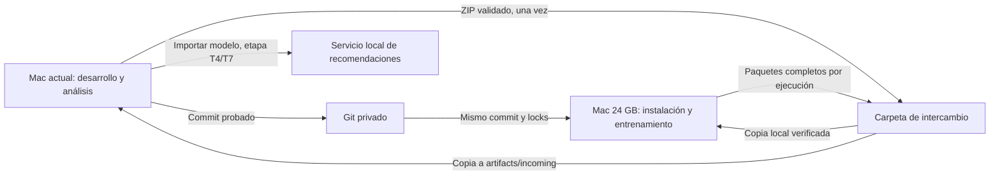

# Entrenamiento reproducible entre dos Macs

Diseño y guía inicial del 19 de octubre de 2026. Extiende el [plan del proyecto](../plans/2026-10-18-plataforma-local-hm.md); no sustituye sus cortes temporales, métricas ni criterios de entrega. **Sólo la instalación de infraestructura de la sección «Qué ejecutar hoy» está implementada.** El entrenamiento, sus órdenes de ejecución y los paquetes de resultados descritos después son trabajo pendiente de T2–T3.

## Decisiones confirmadas y objetivo

El usuario dispone de una segunda Mac Apple Silicon con 24 GB de RAM y eligió Git privado para código, más una carpeta para intercambiar datos y resultados. La Mac actual seguirá siendo el entorno de desarrollo, revisión y, posteriormente, servicio del modelo. La otra ejecutará las pruebas de instalación y los trabajos pesados. No se requieren nube, SSH, un registro privado de imágenes ni Codex en la segunda Mac.

Cada experimento debe poder reconstruirse a partir de un commit, los locks, el ZIP identificado por su SHA-256 y la configuración efectiva. Al devolver los resultados se debe poder determinar qué se ejecutó, si terminó, cuánto consumió y qué calidad obtuvo. Un entrenamiento hecho allá deberá poder importarse y servirse aquí sin reentrenar ni depender del MLflow de origen.

El remoto elegido es [emilianodesu/clothing-recommendation](https://github.com/emilianodesu/clothing-recommendation), configurado como `origin`. En la comprobación del 19 de octubre de 2026 estaba vacío, público y sin permiso de escritura para la sesión GitHub disponible. La publicación está pendiente de hacerlo privado y habilitar escritura; configurar `origin` no sube archivos. Después habrá que comprobar acceso desde ambas Macs. La carpeta puede transferirse por disco externo o red local; su medio concreto no cambia el formato. Antes de entrenar se registrarán CPU, versión de macOS y espacio libre del segundo equipo.

## Flujo entre equipos



Git transporta código, configuración sin secretos, pruebas, documentación y resúmenes aprobados. La carpeta transporta el ZIP, reportes completos, checkpoints y, después, versiones portables. No se copian `.env`, tokens, entornos Python, configuración Docker, volúmenes de PostgreSQL ni la base interna de MLflow. Cada clon genera sus propias credenciales.

Los jobs trabajan en el disco local de la segunda Mac. La carpeta de intercambio sólo recibe archivos cerrados; no se escribe un checkpoint ni una base de datos directamente sobre un directorio sincronizado. El retorno de resultados es manual al principio. Esta conversación puede analizar los archivos cuando estén disponibles en el workspace actual; Git por sí solo no permite consultar la otra Mac ni trae métricas en tiempo real.

## Qué ejecutar hoy: reproducir T1 en la segunda Mac

Primero publicar el repositorio en el remoto privado elegido y darle acceso al usuario de la segunda Mac. La revisión funcional de T1 es `937b7c8bc75fa2e17daea5b7ec6d45c6ec004732`; contiene las 10 pruebas ya verificadas en el equipo original. Para esta primera comprobación se puede fijar ese commit. Para etapas posteriores se entregará el commit exacto que contenga sus comandos: no ejecutar una rama cambiante durante un experimento.

Requisitos: Git, Homebrew, Python 3.9+ y Ruby con YAML, según [la guía de Docker](../../setup.md). Usar una carpeta de trabajo local. **Ejecutar este bloque cuando el código ya esté publicado y exista acceso al repositorio privado.** En la terminal de la segunda Mac:

```bash
git clone https://github.com/emilianodesu/clothing-recommendation.git hm-recommender
cd hm-recommender
git checkout --detach 937b7c8bc75fa2e17daea5b7ec6d45c6ec004732

python3 scripts/setup-docker-macos.py --profile hm-project --cpus 4 --memory 8 --disk 100
export DOCKER_CONTEXT=colima-hm-project
python3 scripts/doctor.py
bash scripts/docker-smoke.sh
python3 scripts/project.py bootstrap
python3 scripts/project.py verify --suite bootstrap
python3 scripts/doctor.py --application
```

Ejecutar una línea a la vez y detenerse ante un fallo. No hace falta transferir H&M para esta prueba. Las imágenes se construyen localmente a partir de Dockerfiles, digests y locks; no se supone que `hmrec-jobs:0.1.0` sea un tag publicado en un registro. Se necesita Internet para las primeras descargas y las CA válidas del propio equipo. Si hay otro contexto Docker configurado por `DOCKER_HOST`, quitar esa variable de esta terminal antes de elegir el contexto local, como indica la guía de Docker.

Primero se usa el mismo presupuesto de recursos que en la Mac actual para comprobar la instalación. No usar `--platform linux/amd64` ni Rosetta: el objetivo de ambos equipos es Linux ARM64 nativo. La prueba demuestra una segunda instalación física ARM64; no acredita Intel/AMD64.

Para devolver evidencia de esta primera instalación, los comandos siguientes **ya existen**. En la segunda Mac, desde el clon:

```bash
mkdir -p artifacts/handoff/bootstrap-mac24
git rev-parse HEAD > artifacts/handoff/bootstrap-mac24/commit.txt
python3 scripts/doctor.py --application --json > artifacts/handoff/bootstrap-mac24/doctor.json
python3 scripts/project.py check > artifacts/handoff/bootstrap-mac24/check.log 2>&1
python3 scripts/project.py verify --suite bootstrap > artifacts/handoff/bootstrap-mac24/verify.log 2>&1
```

Se vuelve a ejecutar la suite para capturar su resultado. Comprobar el código de salida de cada orden (`echo $?` inmediatamente después, antes de otra orden); 0 indica éxito. Si falla, conservar el log y no declarar completada la instalación. Copiar **esa carpeta completa** a `artifacts/incoming/bootstrap-mac24/` dentro del proyecto de la Mac actual. `artifacts/` ya está fuera de Git. Con esos archivos se puede revisar aquí el commit, el entorno y las 10 pruebas sin acceder a la otra computadora. Los logs son evidencia privada; contienen potencialmente rutas locales.

## Traslado de los datos

Transferir una sola vez, usando el acceso autorizado del usuario, `data/kaggle_hm/h-and-m-personalized-fashion-recommendations.zip` a la misma ruta relativa del clon de la segunda Mac. Se puede usar una ruta distinta cuando el importador de T2 exista, pero la primera guía usa la convención actual. El ZIP ocupa 30,810,293,747 bytes, aproximadamente 28.69 GiB. No es necesario volver a descargarlo ni transferir la credencial Kaggle para utilizar esa copia autorizada.

Después de copiar, ejecutar en la segunda Mac:

```bash
shasum -a 256 data/kaggle_hm/h-and-m-personalized-fashion-recommendations.zip
```

El resultado debe ser `e4695ac063fd621a29ba83523aa97be4041a91c45fba331162784f55771fbe9c`, según [la validación existente](../../../evidence/dataset-validation-summary.json). Coincidir con esa huella acredita identidad con el archivo ya validado; T2 añadirá validación estructural y de conteos al procesarlo. Si no coincide, no entrenar con esa copia.

El ZIP conserva imágenes para etapas posteriores, pero T2 extraerá/procesará las tablas por lotes sin expandir todos los JPEG. Si hace falta reintentar una copia, conservar el destino incompleto con nombre temporal y verificarlo antes de renombrarlo al nombre definitivo. La capa de datos deberá conciliar 31,788,324 transacciones, 1,371,980 clientes y 105,542 artículos. Las filas de entrenamiento serán las que correspondan a sus cortes y reglas, no necesariamente todas las transacciones de la capa original.

## Recursos de la Mac de 24 GB

Mantener PyTorch CPU dentro de Linux ARM64 como referencia. MPS sería una ejecución alternativa macOS con validación propia; no es necesario incorporarla para aprovechar la segunda máquina. Tener más RAM no garantiza una aceleración proporcional: CPU, batches y lectura de datos también se medirán.

El presupuesto ampliado es una **propuesta técnica inicial**, pendiente de medir. No es una capacidad de entrenamiento ya demostrada:

| Recurso | Comprobación inicial de T1 | Entrenamiento propuesto en Mac 24 GB |
| --- | --- | --- |
| VM Colima | 4 CPU, 8 GiB | 4 CPU, 14 GiB inicialmente |
| Job | 3 CPU, límite de 5 GiB | 3 CPU, límite de 10 GiB inicialmente |
| Hilos / workers | Límites actuales; workers 0 | Conservar inicialmente; ajustar con evidencia |
| Memoria fuera de Colima | Resto del equipo | Aproximadamente 10 GiB para macOS y otras apps |
| Disco virtual Docker | Máximo de 100 GiB | 100 GiB inicialmente; vigilar espacio real |
| Almacenamiento del proyecto | No necesita H&M para T1 | Procurar al menos 100 GiB libres antes de copiar los datos; medir tras cada etapa |

El objetivo de 100 GiB libres es un margen inicial, no una demostración de que todo el entrenamiento cabe. Docker y el proyecto compiten por el almacenamiento físico aunque sus diagnósticos sean distintos; no sumar su espacio libre como si fueran dos discos independientes. T2–T3 deberán calcular espacio requerido para salidas, checkpoints y copias temporales antes de arrancar cada etapa.

Hoy `compose.yaml` fija `mem_limit: 5g`, `cpus: 3` y límites de hilos. Aumentar sólo la memoria de Colima no cambia esos límites. Antes de entrenar se añadirá un perfil de recursos versionado y validado, separado de los hiperparámetros, y el lanzador aplicará tanto la VM como el límite del job. El preparador Colima admite ya `--memory 14`; se aplicará con los trabajos detenidos y sobre el perfil `hm-project`, conservando volúmenes.

La primera comparación usa igual commit, datos, seed, batch, workers e hilos en ambas Macs sobre un subconjunto determinista. Después se podrá medir el presupuesto ampliado. Si se cambia batch u otro hiperparámetro se registra como experimento distinto. Sólo un trabajo pesado a la vez; no es necesario arrancar interfaz, Airflow ni API para acreditar esta fase. Mantener el equipo conectado a corriente y despierto durante la ejecución; cerrar la tapa o dormirlo puede interrumpir el progreso.

## Siguientes entregables y orden

| Paso | Trabajo que haremos aquí | Ejecución en la Mac 24 GB | Evidencia de salida |
| --- | --- | --- | --- |
| A · Segunda instalación | Publicar commit privado y usar esta guía | T1, sin dataset | Commit, diagnóstico y 10 pruebas satisfactorias |
| B · Datos portables, T2 | Importación/validación, Parquet por mes, features temporales, recursos y registro de ejecuciones | Copiar ZIP, verificar huella, procesar tablas completas | Conteos conciliados, manifiestos, RAM/disco/tiempo; reintento sin duplicados |
| C · Entrenamiento mínimo, T3 | Dos torres, checkpoints reanudables, evaluación y exportación de reportes | Sintéticos y dos tamaños deterministas; después una época sobre todo el conjunto de entrenamiento | Estado, ejemplos consumidos, métricas, pico de RAM, duración y checkpoint |
| D · Análisis de regreso | Importador de reportes y comparación local | Copiar paquete cerrado de cada ejecución | Reporte legible aquí, validación de huellas y comparación con configuración exacta |
| E · Modelo operativo, T4/T7 | Empaquetar/importar versión portable y reconstruir Qdrant | Exportar versión entrenada | Recomendaciones aquí sin entrenar ni conectar con MLflow de allá |

B incluye el registro básico de ejecuciones; C incluye su empaquetado y D su lector, para que el primer entrenamiento remoto ya devuelva resultados útiles. E no es prerrequisito para comparar métricas. Se adelantan de T7 la instalación física y el intercambio de resultados, pero backup/restore completo, activación y prueba sin Internet siguen perteneciendo a T4/T7.

El procesamiento y las features deben pasar las pruebas contra fuga temporal antes de entrenar. Se conservan train anterior al 2020-09-09, validación del 09 al 16 y prueba del 16 al 23 de septiembre. Los pilotos seleccionarán clientes de forma determinista y conservarán su historia, documentando la selección; no se confundirá su medición con entrenamiento masivo. El primer ensayo completo consumirá todos los ejemplos de entrenamiento que T2 declare elegibles. La selección de modelo usará validación; el conjunto final de prueba se reserva para el cierre del proyecto.

## Contrato pendiente: órdenes y resultados de una ejecución

Se añadirá a `scripts/project.py` una interfaz pequeña. **Los siguientes nombres son propuestos y todavía no se pueden ejecutar**:

| Acción propuesta | Responsabilidad |
| --- | --- |
| `run-job --spec RUTA` | Validar commit limpio, entradas y recursos; lanzar ingestión o entrenamiento y devolver `run_id` |
| `run-status --run-id ID` | Estado y progreso persistidos; distinguir en ejecución, finalizado, fallido, interrumpido o estado desconocido |
| `resume-job --run-id ID` | Continuar con checkpoint compatible y la misma configuración; conservar historial de intentos |
| `export-run --run-id ID --output RUTA` | Paquete cerrado de reportes; pesos opcionales mediante bandera explícita |
| `import-run --input RUTA` | Verificar formato/huellas y copiar bajo `artifacts/imported-runs/RUN/ATTEMPT/PACKAGE`, sin ejecutar comandos recibidos |
| `compare-runs --packages ID1 ID2` | Tabla/Markdown con calidad, recursos y diferencias de configuración de dos paquetes explícitos |

`pipeline` continuará siendo el flujo completo del plan. `run-job` permitirá ejecutar sus etapas de datos/modelo de forma aislada mientras se construyen los demás componentes. No se añadirá un planificador distribuido. Las definiciones estarán en `configs/runs/`; los presupuestos en `configs/resources/`. Los adaptadores de T2–T3 reutilizarán las funciones y contratos existentes, no mantendrán una implementación distinta para cada Mac.

Cada job quedará asociado a un commit Git limpio, hash de locks y configuración efectiva, SHA del dataset, manifiesto de features, dispositivo y seed. El arranque rechazará archivos de código versionados modificados o archivos fuente relevantes sin registrar. El lanzador construirá/comprobará la imagen para ese commit y guardará su identidad real; no confiará sólo en el tag local reutilizable `0.1.0`. Un identificador de imagen construida localmente puede diferir entre hosts y se registra como evidencia, sin presentarlo como sustituto de la identidad del código y las dependencias.

El contenedor de trabajo se ejecutará con nombre identificable y sin depender de que una terminal de seguimiento siga abierta. Guardará progreso, logs acotados y checkpoints en el directorio local de la ejecución. Un cierre de terminal no deberá cancelar el cálculo; dormir/apagar el host sí puede detenerlo. Al reanudar se validarán datos, código y configuración, y se restaurarán optimizador, posición en los datos y estados aleatorios. Se guardará estado final aun ante fallo normal; si hay corte de energía o pérdida del proceso, el siguiente diagnóstico marcará estado interrumpido/desconocido en lugar de atribuir éxito. No se borrará automáticamente el contenedor fallido antes de capturar su código de salida y diagnóstico.

Estructura objetivo, todavía no generada por el software:

```text
artifacts/runs/<run_id>/
├── manifest.json            # Versión de formato, commit, inputs, estado y SHA de archivos
├── environment.json         # Alias del equipo, CPU, SO, Docker, paquetes y recursos efectivos
├── config.resolved.json     # Hiperparámetros y cortes efectivos, sin secretos
├── data-report.json         # Filas, exclusiones, particiones y validación
├── training-result.json     # TrainingResult existente, con checkpoint de ruta relativa
├── evaluation.json          # EvaluationReport existente, sólo cuando corresponda
├── resources.csv            # Tiempos, memoria de proceso y contenedor, disco y throughput
├── progress.json            # Estado/progreso; su ausencia no implica éxito
├── summary.md               # Resultado legible y límites del experimento
├── logs/                    # Logs acotados; privados hasta sanitización
└── checkpoints/             # Opcionales en el paquete de retorno
```

Un sobre `RunManifest` versionado complementará `DatasetManifest`, `FeatureManifest`, `TrainingResult` y `EvaluationReport`: `run_id`, `stage`, `attempt`, `status`, `exit_code`, fechas UTC, commit, hashes de configuración/locks/entradas, recursos efectivos y lista de archivos relativos con tamaño y SHA-256. Los reportes usan un alias como `mac24`, sin número de serie, nombre de usuario, credenciales ni listado completo de variables de entorno. Las métricas de RAM deberán indicar si representan proceso o contenedor: no comparar números con denominadores distintos.

El exportador crea el paquete bajo un nombre temporal, valida archivos y lo renombra al terminar. No exporta un checkpoint mientras se está escribiendo. El retorno ligero incluye reportes y métricas, sin perfiles ni IDs de clientes; el paquete con modelo/perfiles permanece privado fuera de Git.

Se distinguen ejecución, intento y paquete: `run_id` identifica un experimento con entradas/código/configuración inmutables; reanudar aumenta `attempt`; cada exportación registra `bundle_kind` (`reports` o `with-checkpoint`) y un `package_id` calculado a partir del manifiesto canónico y las huellas de archivos, excluyendo el propio campo `package_id`. Así pueden coexistir el diagnóstico fallido, el reintento exitoso y una exportación posterior con pesos. Se almacenan bajo `artifacts/imported-runs/<run_id>/<attempt>/<package_id>/` sin sobrescribirse; las comparaciones nombran paquetes concretos. Una ejecución con diferente código, datos o hiperparámetros necesita un `run_id` nuevo. El importador rechaza reutilizar el mismo `run_id` para esa identidad distinta, pero acepta nuevos intentos o tipos de paquete compatibles.

El importador rechaza huellas incorrectas, rutas absolutas, `..`, enlaces fuera del destino y versiones de formato desconocidas. Importar dos veces el mismo `package_id` y contenido es idempotente; una discrepancia se rechaza. La identidad del paquete se comprueba, pero no se ejecutan scripts ni instrucciones embebidas en logs.

## Lectura aquí y criterios de aceptación

Se depositará cada paquete recibido en `artifacts/incoming/` dentro de este repositorio. El importador generará su resumen en `artifacts/imported-runs/`; sólo una versión sanitizada del resumen pasará a `evidence/` y Git. MLflow podrá seguir siendo el registro local de T3, pero el intercambio debe funcionar con los archivos exportados aun cuando su servidor no esté accesible. No se copiará su base PostgreSQL para consultar una corrida.

Para dar por acreditada la ejecución en la segunda Mac se exigirán: commit exacto, dataset coincidente, pruebas satisfactorias, recursos efectivos registrados, conteos conciliados y un resultado de entrenamiento con salida 0 y ejemplos consumidos comprobables. Un log que termina o una barra al 100 % no son suficientes. Una corrida fallida sigue produciendo un paquete de diagnóstico, sin mezclarse con resultados válidos.

Se distinguirán tres pruebas: reinstalar la infraestructura, repetir un entrenamiento y servir el mismo modelo exportado. No se promete igualdad bit a bit de pesos por fijar una seed; PyTorch documenta límites de reproducibilidad entre plataformas y versiones. Se usarán tolerancias numéricas explícitas y pruebas repetidas pequeñas para establecer criterios antes de comparar las corridas mayores. Importar el mismo modelo exige identidad de archivos y puntuaciones dentro de la tolerancia acordada; reentrenar exige configuración/entradas trazables y métricas dentro de los criterios declarados. El ensayo remoto no autoriza ajustar hiperparámetros contra el test final.

Pruebas que se añadirán junto a estos componentes: recursos solicitados realmente aplicados; código/inputs distintos rechazados al reanudar; cierre del seguimiento sin detener el job; recuperación de checkpoint; fallo sin falso éxito; exportación atómica; paquete corrupto/inseguro rechazado; importación repetida sin duplicados; importar fallo, reintento exitoso y pesos adicionales sin colisión ni sobrescritura; lectura del resumen sin MLflow original. Las pruebas de datos y modelo existentes en el plan siguen siendo obligatorias.

## Pendientes y fuentes

Las decisiones de arquitectura y transporte están tomadas y la URL del remoto ya está elegida. Para ejecutar A falta configurar su visibilidad privada, habilitar escritura para publicar los commits y comprobar acceso desde ambos equipos. El espacio libre y la capacidad de entrenamiento de la Mac 24 GB se medirán allí. Si el almacenamiento no alcanza, se ajustará su ubicación/margen antes de procesar el histórico. Los comandos nuevos, el perfil ampliado y el empaquetado de resultados deben implementarse antes de pedirle al operador que entrene.

Decisiones propuestas por el constructor: CPU como referencia, primero mismo presupuesto y después 14 GiB de VM/10 GiB de job; transferencia manual de paquetes cerrados; guardar métricas sin depender de MLflow; adelantar la prueba física de T7. Todas conservan el objetivo local y reproducible del proyecto. Los tamaños finales de batch, frecuencia de checkpoint, intervalos de progreso y tolerancias se fijarán con mediciones y pruebas sintéticas, versionados antes del ensayo completo.

Fuentes consultadas el 19 de octubre de 2026:

- [Colima: recursos y configuración de VM](https://github.com/abiosoft/colima#customizing-the-vm).
- [PyTorch 2.14: reproducibilidad](https://docs.pytorch.org/docs/2.14/notes/randomness.html).
- [PyTorch 2.14: backend MPS en macOS](https://docs.pytorch.org/docs/2.14/notes/mps.html).
- [Guía local de bootstrap](../../bootstrap.md), [plan T1–T8](../plans/2026-10-18-plataforma-local-hm.md) y [validación del ZIP](../../../evidence/dataset-validation-summary.json).
