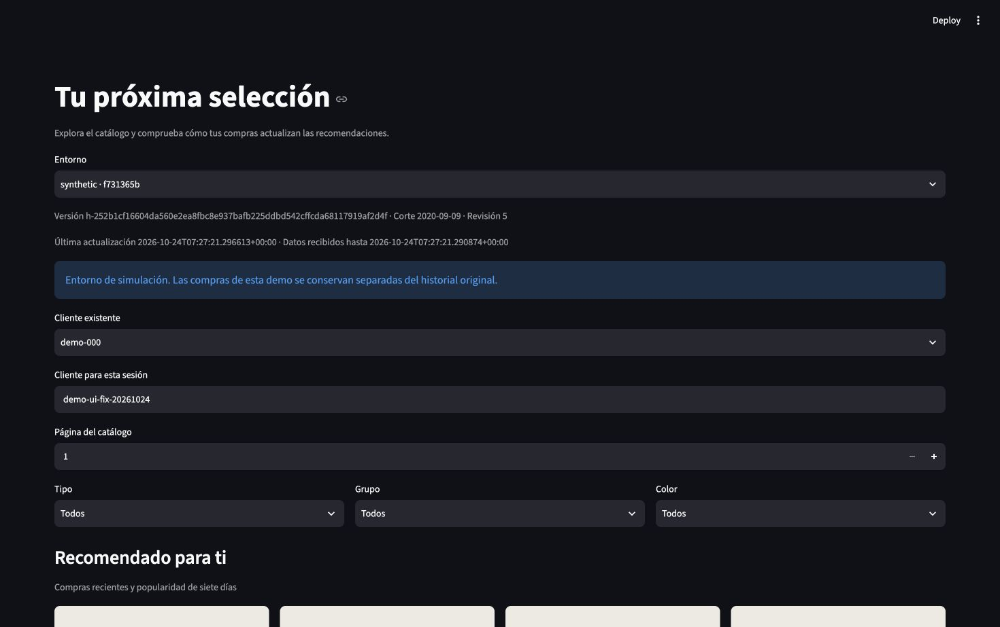

# Actualización local de cabecera — 2026-10-24

La UI sintética local se actualizó al código `e478f71`. [Evidencia](../evidence/ui-metadata-deployment-local.json): revisión visible 4 → 5 y fechas nuevas después de una compra y una publicación sintéticas. API y PostgreSQL conservaron ID, imagen y hora de inicio. No se tocó mac24 ni se repitieron experimentos.



## Identidad y rollback

La imagen candidata se construyó con Dockerfile/lock del checkout limpio y CA local, tag independiente `hmrec-app:ui-e478f71`. Se comparó SHA-256 de `/opt/hmrec/src/hm_recommender/ui/app.py` con el archivo del checkout. No se cambió el tag compartido `hmrec-app:0.1.0`.

Docker no pudo crear un snapshot de la UI anterior: faltaba una capa histórica en su almacén. Se reconstruyó `hmrec-ui-rollback:pre-e478f71` desde el checkout limpio `6130943`, comprobando igualdad del archivo UI con el contenedor anterior. Es rollback de código reconstruido, no una copia idéntica de bytes de la imagen original. No se borraron capas ni volúmenes para eludir el error.

## Procedimiento reproducible

Para otra instalación, identificar primero su directorio Compose, `.env` propio, proyecto y contexto. Comprobar que se trata de una demo sintética; no trasladar estas órdenes automáticamente a mac24. Registrar IDs, imágenes y hora de inicio de API/PostgreSQL, guardar una imagen de rollback válida y verificar capacidad antes de construir.

Construir app desde el commit elegido con `docker/app.Dockerfile` y el secreto `build_ca` de esa instalación. Crear un override privado que afecte únicamente a UI:

```yaml
services:
  ui:
    image: hmrec-app:ui-e478f71
```

Aplicar usando la configuración original y ese override, con `up -d --no-deps --no-build --pull never --wait --wait-timeout 90 ui`. Deben proporcionarse explícitamente `--project-directory`, `--env-file`, ambos `-f` y `--project-name` de la instalación. No imprimir `compose config` con secretos ni copiar `.env` entre equipos.

La instalación local usa sus archivos privados de override en `.runtime/ui-metadata-deploy/`; un `up` futuro sin override podría seleccionar nuevamente el tag compartido antiguo. Conservar y utilizar el override al operar esta demo. Para revertir, emplear el override de rollback, con los mismos argumentos y sólo `ui`, y volver a comprobar salud e identidades; no se ejecutó rollback durante esta comprobación.

La verificación incluyó healthcheck UI y navegador real sobre 24 artículos sintéticos: comprador `demo-ui-fix-20261024`, una compra y una actualización, revisión 4 → 5. La compra queda persistida en el stream de demo. Las capturas originales del tag académico se conservan sin editar; esta captura documenta la corrección posterior. La aceptación sintética completa anterior mantiene su commit y alcance: no se atribuye a este despliegue una nueva ejecución de sus 60 casos.
